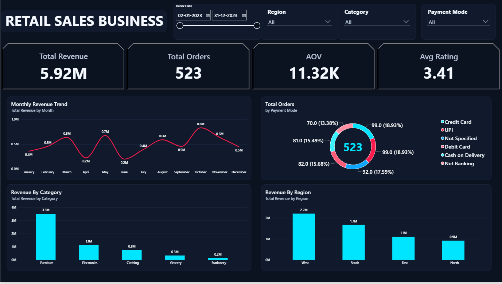
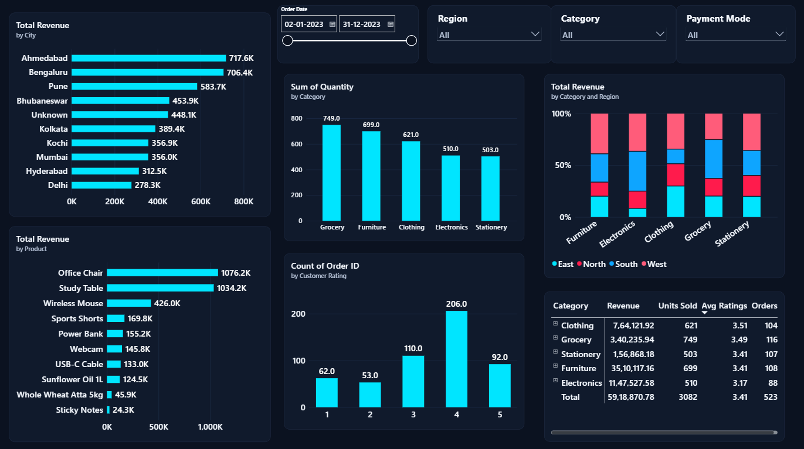

# Retail Sales Business Dashboard

A two-page Power BI dashboard that looks at one year of retail sales (January to December 2023). It tracks revenue, orders, average order value and customer ratings, and breaks them down by month, category, region, city, product and payment mode.

---

## What I wanted to find out

- How much revenue did the business make, and how did it change through the year?
- Which categories, products, regions and cities bring in the most money?
- Is the revenue coming from the products that sell the most units?
- How do customers pay, and how happy are they?

---

## Dashboard pages

### 1. Overview

The big picture: headline KPIs, the monthly trend, order split by payment mode, and revenue by category and region.



- **Total revenue: 5.92M** from **523 orders**
- **Average order value (AOV): about 11.32K**
- **Average customer rating: 3.41**
- Revenue is uneven through the year. **October** is the strongest month (about 0.8M), followed by May (0.7M) and March (0.6M), while **April and June** drop to around 0.2M
- **Furniture** alone brings in 3.5M, which is around 59% of total revenue. Electronics (1.1M) and Clothing (0.8M) follow, with Grocery and Stationery far behind
- **West** is the top region at 2.2M, then South (1.7M), East (1.1M) and North (0.9M)
- Orders are spread fairly evenly across payment modes (roughly 13% to 19% each), with Credit Card and UPI at the top with 99 orders each

### 2. Detailed Analysis

A closer look at cities, products, quantity sold, ratings and category performance.



- **Top cities by revenue:** Ahmedabad (717.6K), Bengaluru (706.4K) and Pune (583.7K)
- **Top products:** Office Chair (1.08M) and Study Table (1.03M) are far ahead of everything else. Wireless Mouse is third at 426K
- **Grocery sells the most units (749) but earns little revenue**, while Furniture sells fewer units (699) and earns the most. High-priced items matter more than volume here
- **Ratings:** 4 stars is the most common rating (206 orders), and 1 and 2 stars together account for 115 orders
- **Electronics has the lowest average rating (3.17)** and the fewest orders (88). Clothing is rated best at 3.51
- The category and region chart shows that every category is sold across all four regions, with no single region dominating any one category

---

## Key takeaways

1. **Furniture drives the business.** Three out of every five rupees come from one category, mainly Office Chairs and Study Tables.
2. **Revenue is seasonal.** There are sharp dips in April and June and peaks in March, May and October, so planning stock and campaigns around these months could help.
3. **Electronics needs attention.** It is the second biggest category by revenue but has the lowest ratings, which may point to product or delivery problems.
4. **Volume is not value.** Grocery and Stationery sell plenty of units but add very little to revenue.
5. **Some data is missing.** A few orders have an unknown city or an unspecified payment mode, so those groups show up as "Unknown" and "Not Specified".

---

## Features

- Interactive filters for **order date, region, category and payment mode** on both pages
- KPI cards for revenue, orders, AOV and average rating
- Line, bar, stacked bar and donut charts, plus a summary table by category
- Dark theme with cyan and red accents

---

## Repository structure

```
retail-sales-dashboard/
├── images/
│   ├── overview.png
│   └── detailed-analysis.png
└── README.md
```

Add your `.pbix` file (and data, if you are sharing it) to the root of the repo and list it here.

---

## How to use it

1. Clone or download this repository
   ```bash
   git clone https://github.com/<your-username>/<your-repo-name>.git
   ```
2. Open the `.pbix` file in [Power BI Desktop](https://powerbi.microsoft.com/desktop/)
3. Use the filters at the top of each page to explore the data

---

## Tools used

- **Power BI Desktop** for the data model, DAX measures and visuals

---

## What I'd do next

- Add a month-over-month growth measure and compare against the previous period
- Investigate why April and June are so weak
- Dig into Electronics ratings to see which products or cities are pulling them down
- Reduce the "Unknown" city and "Not Specified" payment values by fixing them at the source

---

## About me

Created by **Surya Bhola** as part of my data analyst portfolio.

- LinkedIn: [linkedin.com/in/suryabhola-da](https://www.linkedin.com/in/suryabhola-da)
- Email: [isuryabhola@gmail.com](mailto:isuryabhola@gmail.com)

Feedback and suggestions are always welcome.
